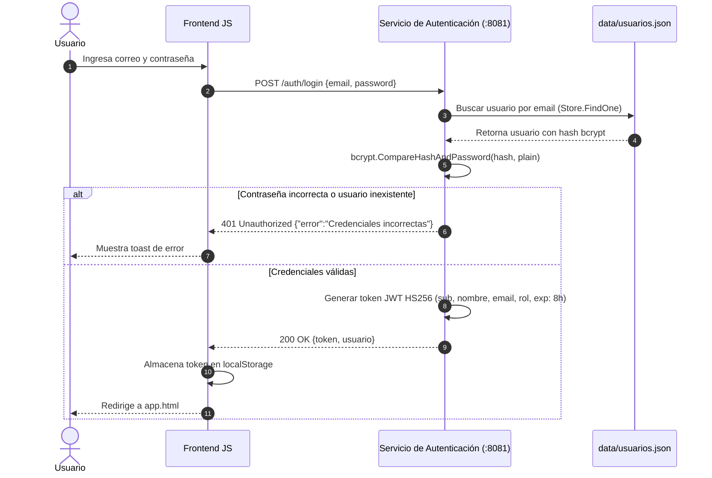
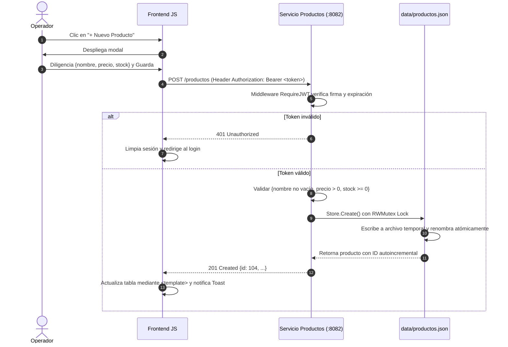
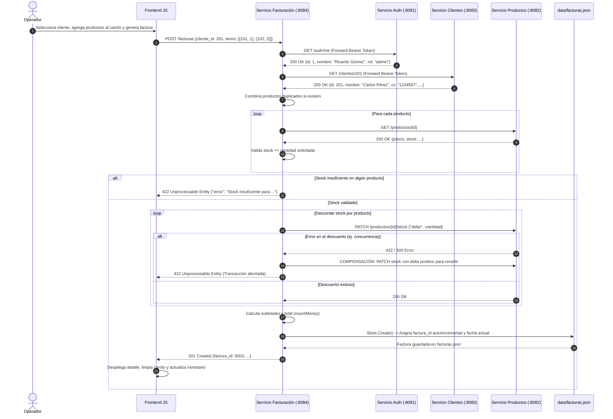

# Documento Técnico: Sistema de Facturación Digital con Microservicios

**Asignatura:** Programación Avanzada 2026_2  
**Fecha:** Octubre 2026  
**Lenguajes y Tecnologías:** Go 1.22+, Vanilla JavaScript (ES Modules), Bootstrap 5, jsPDF, REST/JSON.

---

## 1. Introducción y Objetivo

El presente proyecto implementa un **Sistema de Facturación Digital** basado en una **arquitectura orientada a microservicios** independientes. El sistema permite administrar usuarios, catálogo de productos con control de existencias en tiempo real, registro de clientes y la emisión, consulta y exportación de facturas de venta oficiales.

### Objetivos Principales:
- Diseñar e implementar microservicios desacoplados en Go utilizando exclusivamente la librería estándar `net/http` con el enrutador nativo de Go 1.22 (`ServeMux`).
- Garantizar la persistencia de datos segura y concurrente sobre archivos JSON atómicos (`sync.RWMutex` + reemplazo atómico de archivo temporal).
- Centralizar la seguridad con tokens JWT (`HS256`) y encriptación de contraseñas mediante `bcrypt`.
- Implementar un microservicio de orquestación transaccional (Facturación) capaz de validar clientes, sincronizar productos, aplicar control de concurrencia en stock y ejecutar compensación ante fallas (patrón Saga básico).
- Proveer un frontend desacoplado (HTML semántico + JavaScript Vanilla) preparado para adopción de diseño con Google Stitch mediante el contrato de selectores `data-hook`.

---

## 2. Arquitectura del Sistema

El ecosistema está integrado por 5 binarios independientes:
1. **Servicio de Autenticación** (`:8081`): Emisión y validación de tokens JWT, registro y hash bcrypt.
2. **Servicio de Productos** (`:8082`): CRUD de catálogo y actualización atómica de existencias.
3. **Servicio de Clientes** (`:8083`): CRUD de clientes y validación de unicidad de cédula/correo.
4. **Servicio de Facturación** (`:8084`): Consumidor y orquestador transaccional que consolida ventas.
5. **Servidor Web Estático** (`:3000`): Servidor HTTP en Go para el frontend.

### Diagrama General de Arquitectura (Mermaid)

```mermaid
graph TD
    subgraph Cliente ["Capa de Presentación"]
        Browser["Navegador Web (Frontend JS / Bootstrap 5 / jsPDF)"]
        WebServer["cmd/web (Servidor Estático :3000)"]
    end

    subgraph Microservicios ["Capa de Negocio (Go net/http)"]
        AuthSvc["Auth Service (:8081)"]
        ProdSvc["Productos Service (:8082)"]
        CliSvc["Clientes Service (:8083)"]
        FactSvc["Facturación Service (:8084)"]
    end

    subgraph Persistencia ["Capa de Persistencia (Almacén JSON Atómico)"]
        DBUsers[("data/usuarios.json")]
        DBProd[("data/productos.json")]
        DBCli[("data/clientes.json")]
        DBFact[("data/facturas.json")]
    end

    Browser -->|Descarga UI| WebServer
    Browser -->|POST /auth/login, /register| AuthSvc
    Browser -->|GET, POST, PUT, DELETE /productos| ProdSvc
    Browser -->|GET, POST, PUT, DELETE /clientes| CliSvc
    Browser -->|GET, POST /facturas| FactSvc

    FactSvc -->|GET /auth/me| AuthSvc
    FactSvc -->|GET /clientes/{id}| CliSvc
    FactSvc -->|GET /productos/{id}| ProdSvc
    FactSvc -->|PATCH /productos/{id}/stock| ProdSvc

    AuthSvc -.-> DBUsers
    ProdSvc -.-> DBProd
    CliSvc -.-> DBCli
    FactSvc -.-> DBFact
```

---

## 3. Catálogo Completo de Endpoints

### 3.1. Servicio de Autenticación (`puerto 8081`)

| Método | Ruta | Autenticación | Body (Request) | Respuestas | Códigos |
| :--- | :--- | :--- | :--- | :--- | :--- |
| `POST` | `/auth/register` | Pública | `{"nombre":"...","email":"...","password":"..."}` | `{"id":3,"nombre":"...","email":"...","rol":"cliente"}` | `201`, `400`, `409`, `500` |
| `POST` | `/auth/login` | Pública | `{"email":"...","password":"..."}` | `{"token":"ey...","usuario":{...}}` | `200`, `400`, `401`, `500` |
| `GET` | `/auth/me` | Bearer JWT | *Ninguno* | `{"id":1,"nombre":"...","email":"...","rol":"admin"}` | `200`, `401`, `404`, `500` |
| `GET` | `/health` | Pública | *Ninguno* | `{"status":"ok","servicio":"autenticacion"}` | `200` |

#### Ejemplo Request/Response - Login:
```http
POST /auth/login HTTP/1.1
Content-Type: application/json

{
  "email": "ricardo@example.com",
  "password": "admin123"
}
```
```http
HTTP/1.1 200 OK
Content-Type: application/json; charset=utf-8

{
  "token": "eyJhbGciOiJIUzI1NiIsInR5cCI6IkpXVCJ9...",
  "usuario": {
    "id": 1,
    "nombre": "Ricardo Gómez",
    "email": "ricardo@example.com",
    "rol": "admin"
  }
}
```

---

### 3.2. Servicio de Productos (`puerto 8082`)

| Método | Ruta | Autenticación | Body (Request) | Respuestas | Códigos |
| :--- | :--- | :--- | :--- | :--- | :--- |
| `GET` | `/productos` | Bearer JWT | *Ninguno (opcional `?q=`)* | `[{"id":101,"nombre":"...","precio":3500000,"stock":15},...]` | `200`, `401`, `500` |
| `GET` | `/productos/{id}`| Bearer JWT | *Ninguno* | `{"id":101,"nombre":"...","precio":3500000,"stock":15}` | `200`, `401`, `404`, `500` |
| `POST` | `/productos` | Bearer JWT | `{"nombre":"...","precio":12000,"stock":50}` | `{"id":104,"nombre":"...","precio":12000,"stock":50}` | `201`, `400`, `401`, `500` |
| `PUT` | `/productos/{id}`| Bearer JWT | `{"nombre":"...","precio":15000,"stock":45}` | `{"id":104,"nombre":"...","precio":15000,"stock":45}` | `200`, `400`, `401`, `404` |
| `DELETE`| `/productos/{id}`| Bearer JWT | *Ninguno* | *Sin contenido* | `204`, `401`, `404`, `500` |
| `PATCH`| `/productos/{id}/stock`| Bearer JWT | `{"delta": -2}` | `{"id":101,"nombre":"...","precio":3500000,"stock":13}` | `200`, `400`, `401`, `404`, `422` |
| `GET` | `/health` | Pública | *Ninguno* | `{"status":"ok","servicio":"productos"}` | `200` |

---

### 3.3. Servicio de Clientes (`puerto 8083`)

| Método | Ruta | Autenticación | Body (Request) | Respuestas | Códigos |
| :--- | :--- | :--- | :--- | :--- | :--- |
| `GET` | `/clientes` | Bearer JWT | *Ninguno (opcional `?q=`)* | `[{"id":201,"nombre":"...","cc":"123","email":"...","direccion":"..."},...]` | `200`, `401`, `500` |
| `GET` | `/clientes/{id}` | Bearer JWT | *Ninguno* | `{"id":201,"nombre":"...","cc":"123","email":"...","direccion":"..."}` | `200`, `401`, `404`, `500` |
| `POST` | `/clientes` | Bearer JWT | `{"nombre":"...","cc":"102030","email":"...","direccion":"..."}` | Objeto creado | `201`, `400`, `401`, `409` |
| `PUT` | `/clientes/{id}` | Bearer JWT | `{"nombre":"...","cc":"102030","email":"...","direccion":"..."}` | Objeto actualizado | `200`, `400`, `401`, `404`, `409` |
| `DELETE`| `/clientes/{id}` | Bearer JWT | *Ninguno* | *Sin contenido* | `204`, `401`, `404`, `500` |
| `GET` | `/health` | Pública | *Ninguno* | `{"status":"ok","servicio":"clientes"}` | `200` |

---

### 3.4. Servicio de Facturación (`puerto 8084`)

| Método | Ruta | Autenticación | Body (Request) | Respuestas | Códigos |
| :--- | :--- | :--- | :--- | :--- | :--- |
| `POST` | `/facturas` | Bearer JWT | `{"cliente_id":201,"items":[{"producto_id":101,"cantidad":1}]}` | Objeto Factura oficial | `201`, `400`, `401`, `404`, `422`, `502` |
| `GET` | `/facturas` | Bearer JWT | *Ninguno* | `[{"factura_id":5002,...},{"factura_id":5001,...}]` (descendente) | `200`, `401`, `500`, `502` |
| `GET` | `/facturas/{id}` | Bearer JWT | *Ninguno* | Objeto Factura oficial | `200`, `401`, `404`, `500` |
| `GET` | `/facturas/{id}/descargar`| Bearer JWT | *Ninguno* | Archivo adjunto `factura-{id}.json` | `200`, `401`, `404`, `500` |
| `GET` | `/health` | Pública | *Ninguno* | `{"status":"ok","servicio":"facturacion"}` | `200` |

---

## 4. Flujos del Sistema con Diagramas de Secuencia

### 4.1. Flujo de Autenticación (Login con JWT)



### 4.2. Flujo de CRUD de Productos / Clientes



### 4.3. Flujo Transaccional de Facturación (Validación, Descuento y Compensación)



---

## 5. Estructura y Ejemplo de Factura Generada

El sistema produce facturas con la siguiente estructura JSON estricta y validada:

```json
{
  "factura_id": 5001,
  "cliente": {
    "id": 201,
    "nombre": "Carlos Pérez",
    "cc": "1234567",
    "email": "carlos@example.com",
    "direccion": "Calle 123 #45-67, Bogotá"
  },
  "usuario": {
    "id": 1,
    "nombre": "Ricardo Gómez",
    "rol": "admin"
  },
  "productos": [
    {
      "id": 101,
      "nombre": "Laptop Lenovo ThinkPad",
      "cantidad": 1,
      "precio_unitario": 3500000.00,
      "subtotal": 3500000.00
    },
    {
      "id": 102,
      "nombre": "Mouse inalámbrico Logitech",
      "cantidad": 2,
      "precio_unitario": 12000.00,
      "subtotal": 24000.00
    }
  ],
  "total": 3524000.00,
  "fecha": "2026-10-18"
}
```

---

## 6. Decisiones Técnicas de Diseño

1. **Persistencia Genérica en JSON Concurrente (`internal/jsondb`):**
   - Se utiliza una estructura genérica `Store[T]` parametrizada en Go.
   - Todo acceso está custodiado por un `sync.RWMutex`: lecturas concurrentes (`RLock`) y escrituras exclusivas (`Lock`).
   - La persistencia utiliza **escritura atómica**: se escribe primero un archivo temporal en el mismo directorio (`os.CreateTemp`) y luego se sustituye mediante `os.Rename`. Esto impide la corrupción del archivo en caso de fallo o caída de energía.

2. **Control de Stock Atómico y Compensación:**
   - Para descontar o reponer existencias, el endpoint `PATCH /productos/{id}/stock` opera dentro del lock exclusivo (`WithLock`) evaluando si `stock + delta < 0`.
   - Si durante una factura multi-ítem el descuento del segundo o tercer producto falla, el servicio de Facturación ejecuta la **compensación inversa** emitiendo deltas positivos a los productos ya modificados antes de retornar el error `422`.

3. **Autenticación con JWT Compartido:**
   - La firma y validación se centralizan en HMAC-SHA256 (`HS256`) con clave simétrica leída desde `JWT_SECRET`.
   - La expiración se establece en 8 horas.
   - El servicio de facturación no sólo valida el token mediante middleware, sino que consulta directamente a `GET /auth/me` para capturar el perfil completo y actualizado del facturador.

4. **Frontend Desacoplado para Google Stitch:**
   - La arquitectura UI separa completamente la presentación de la lógica.
   - Ninguna línea de JavaScript consulta clases CSS (como `.card` o `.btn`). Toda consulta al DOM se efectúa mediante selectores `[data-hook="..."]`.
   - El renderizado de listas repetitivas delega en fragmentos `<template>` para que la estructura HTML pueda rediseñarse sin alterar los bindings funcionales.

---

## 7. Instrucciones de Ejecución y Pruebas

### Requisitos:
- Go 1.22 o superior instalado.
- Navegador web moderno.

### Comandos de Ejecución Rápida:
- **Comando Único Directo en Go (Recomendado):**
  Desde la carpeta raíz `CRUD/` o desde `facturacion-microservicios/`:
  ```bash
  go run .
  ```
  Inicia concurrentemente los 4 microservicios (`:8081`, `:8082`, `:8083`, `:8084`) y el servidor web (`:3000`). Para detenerlos se pulsa `Ctrl + C`.

- En Linux / macOS con script:
  ```bash
  chmod +x run-all.sh
  ./run-all.sh
  ```
- En Windows (PowerShell con script):
  ```powershell
  .\run-all.ps1
  ```
- O usando Make:
  ```bash
  make run
  ```

### Ejecutar Pruebas Automatizadas:
```bash
make test
# o directamente:
go test -v ./...
```

### Exportación a PDF de este Documento:
Si cuenta con **Pandoc** y **wkhtmltopdf** o **Weasyprint**, puede generar el PDF mediante:
```bash
pandoc docs/DOCUMENTO_TECNICO.md -o docs/DOCUMENTO_TECNICO.pdf --pdf-engine=wkhtmltopdf
```
Alternativamente, puede abrir el archivo Markdown en Visual Studio Code o cualquier visor con vista previa y seleccionar **"Imprimir a PDF"** desde el navegador.
